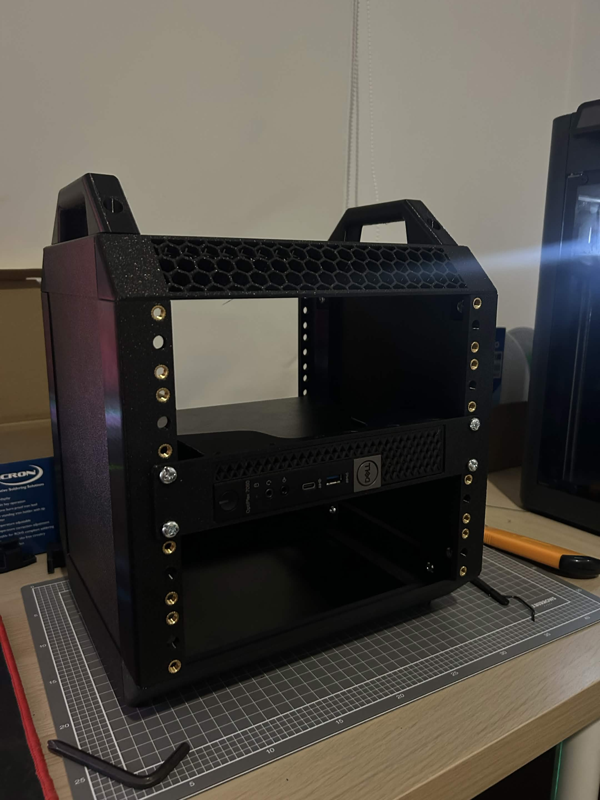

## Table of Contents

- [Hardware Overview](#hardware-overview)
- [Rack](#rack)
- [Optiplex Shelf](#optiplex-shelf)

# Hardware Overview

This section covers the components I used with more detail than the readme. This includes the 3D prints that I used to make the rack, what I ordered for the homelab, and how I assembled it.

## 3D print Overview

I bought a Bambu Lab P1S with the intention of printing parts for my car, and specifically, my homelab. From the point where jellyfin and my media stack is setup, I had not added my DAS, switch, and mini PC to a rack.\
My intention with printing is to:

1. Print a rack
2. Make my own DAS and replace the one I bought (integrated into the rack)

The reason why I intend to make my own DAS when I have one is because I think it looks cleaner and more portable. The DAS I bought it really heavy compared to ASA filament and I can print more HDD slots when I buy more drives. To me, it seems more convenient and looks much cleaner.

[Link to makerworld homelab collection](https://makerworld.com/en/collections/41382125-homelab)

## 3D print setup

- Printer: Bambu Lab P1S (non AMS)
- Filament: ASA black
  

# Rack

I used [mklements: Lab Rax 10" 5U Server Rack](https://makerworld.com/en/models/1294480-lab-rax-10-server-rack-5u?from=search#profileId-1325352) design with the intention of making my homelab slightly portable especially at the early stage of its development. Furthermore, this design offers vertical scaling by printing extension parts.

## Parts Used

- [Rapid PETG black filament](https://www.jaycar.com.au/elegoo-rapid-petg-filament-black-1-75mm-1kg/p/TL6509)
- [M6 10mm Bolts](https://www.bunnings.com.au/pinnacle-m6-x-10mm-zinc-plated-round-head-bolts-and-nuts-10-pack_p0247273)
- [M6x5x8 Brass Inserts](https://www.amazon.com.au/dp/B0H7L5ZN6M?ref=ppx_yo2ov_dt_b_fed_asin_title&th=1)

## Development Process

Each plate was 3D printed, but I rather than printing the top plate, and top front edge, I went for a cleaner look where I used the bottom and back top edge. \
For the front, I used spare brass inserts but didnt have enough for the full length, so I went up by each unit as I have the intention to purchase/ build 1U parts.

# Optiplex Shelf

As seen in the image above, the dell optiplex I use is mounted to the rack. I used [Psychobob's 10" rack Optiplex shelf](https://makerworld.com/en/models/2116002-10-rack-optiplex-shelf-rear-bracket-support#profileId-2289837), but because I did not have enough brass fitments or long enough bolts, I did not print the back supports, but the front mount handles the weight of the optiplex fine.

# HDD Shelf

I wanted a hot swappable HDD shelf on my homelab. I currently use a large DAS that does not fit in the mini rack, but I want a more compact design that is easy to move around when needed.

I had to figure out a way to connect the HDD to the Optiplex. One way was to swap the m.2 SSD with a M.2. - SATA, but that meant sacrificing a drive for booting. I also did not want to clone the current SSD. Therefore, I opted for connecting it via USB which my previous DAS used to connect to the optiplex

## Parts used

- [Nautilus Forge 10" Rack 1U V2 Design](https://makerworld.com/en/models/1400538-10-inch-rack-1u-2-x-3-5-inch-hdd-hot-swap#profileId-3241847)
- [CY 3.5 & 2.5 Inch SATA 22Pin 7+15 Male to SATA 22Pin 7+15 Female Extension Converter Adapter with Screw Holes](https://www.amazon.com.au/dp/B00EK9B13W?ref=ppx_yo2ov_dt_b_fed_asin_title&th=1)
- [USB A to SATA Adapter](https://www.amazon.com.au/dp/B0FK2JFGTP?ref=ppx_yo2ov_dt_b_fed_asin_title)
- [AC to DC 12V power adapter](https://www.amazon.com.au/dp/B07MM14TQC?ref=ppx_yo2ov_dt_b_fed_asin_title&th=1)
- [3.5" SAS hard drive tray](https://www.amazon.com.au/dp/B0DJL65NPM?ref=ppx_yo2ov_dt_b_fed_asin_title)

The reason why I chose Nautilus Forge's design was because it allows for ventilation and shows the parts that are required in the description, and shows the SATA male to female that is recommended to use to screw into the shelf. The problem is, it doesnt explicitly say how to connect via HDD, which I had to research to figure out myself, not that it should though.
