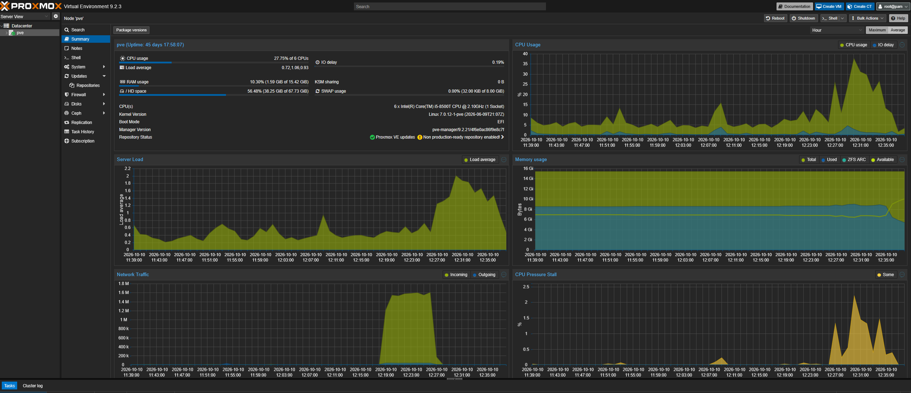

# HomeLab 
 

## Overview
The main objective with the HomeLab is to get out of paying for subscription services and to learn and implement containerisation and cloud native tools, such as Docker. 
\
\
On the host machine I used Proxmox. Proxmox allowed me to make both LXC and Containers for VM's. Also allowing me to view a full web GUI interface to view and manage containers. \
\

## Specs
Host Machine: Dell OptiPlex 7060 \
Switch: NetGear GS724T \
DAS: Yottamaster DataStriver

## Order of Imlementation 
1. OpenMediaVault
2. Media Stack
