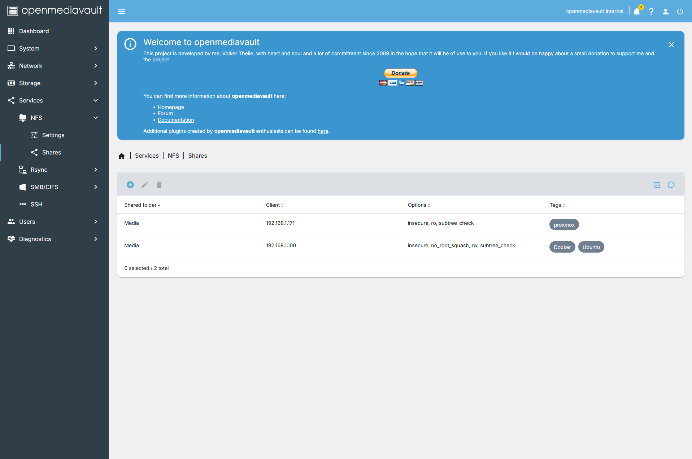

# Media Stack

## Overview
Netflix or other media servers actively remove some of your favourite movies and tv shows. The solution is to implement our own media stack. For this I used:
  1. Jellyfin LXC
  2. Dockerised Container for automated media management tools. 
  
## Stack Overview
- **Jellyfin LXC** 
  - access and watch media on the jellyfin web apps.
- **Ubuntu VM with Docker** 
  - containerise the indexers, media management tools, and routing
  - install nfs-common
- **Prowlarr**: 
  - Indexer manager
- **Radarr, Sonarr**: 
  - track, download, and organise digital 
- **Private Internet Access**: 
  - While a self-hosted VPN grants secure remote access to your homelab, a commercial VPN is essential for media downloaders. Routing your download client through PIA (e.g., via a Gluetun sidecar container) masks your home IP address from public trackers and prevents leaks.
- **download client**:
  - where you are getting your media from. 
- **OMV**:
  - Downloads media to the setup drives. 

## setup:
- ID for jellyfin: 210
- ID for Ubuntu VM: 100

## Creating a shared folder to download media to:
1. on OMV go to: Storage -> shared folders then create a shared folder named Media which uses your HDD mounted previously.
2. Go to services -> NFS -> Shares. Then give access to your Ubuntu VM. Personally, I gave access to my Proxmox as well. 



## mounting an NFS for the Ubuntu VM
Mounting a folder is essential so that the managers can download media to the folders.

on the ubuntu vm:
1. Make a mount point:
    - `sudo mkdir -p /mnt/media-nfs`
2. configure persistant automounting in `/etc/fstab` using vi or nano
    - `(omv ip):/export/Media /mnt/media-nfs nfs defaults 0 0`
      - **Note:** `/export` is essentially just OMV's prefix for a default path. Media is what we made for the NFS share on the OMV web GUI.  
3. Apply and test whether it was mounted:
    - `sudo systemctl daemon-reload`
    - `sudo mount -a` 

# Docker Compose Stack

| Service     | Port    | Purpose                                 |
| :---        | :---    | :---                                    |
| gluetun     | No port | PIA VPN tunnel (OpenVPN, Au Perth)      |
| download_client | 8080    |  routes through gluetun  |
| prowlarr    | 9696    | Indexer manager                         |
| radarr      | 7878    | Movie automation                        |
| sonarr      | 8989    | TV show automation                      |

\
Key compose details:
- All containers share `/mnt/media-nfs` NFS mount from OMV
- VPN provider: PIA (OpenVPN, Au Perth)
- PIA credentials: login that PIA sent via email


## Docker Commands
| Command | Description | 
| ----- | ----- | 
| `docker compose up -d`  | Start stack (generally should do this every time you change your `docker-compose.yml`) | 
| `docker compose down`   | Stop stack | 
| `docker ps`              | Check all containers are running | 
| `docker logs gluetun --tail 20` | View recent logs for the VPN container | 
| `docker exec {download_client} curl ifconfig.me` | Verify qBittorrent is using the VPN | 
| `docker compose restart <container_name>` | Restart a single container |

## docker compose 
I made a media-stack directory where I hold the docker compose. Then I made a docker-compose.yml with vi.  
```bash
services:
  gluetun:
    image: qmcgaw/gluetun
    container_name: gluetun
    cap_add:
      - NET_ADMIN
    devices:
      - /dev/net/tun:/dev/net/tun
    environment:
      - VPN_SERVICE_PROVIDER=private internet access
      - VPN_TYPE=openvpn
      - OPENVPN_USER=${PIA_username}        # replace with your PIA username
      - OPENVPN_PASSWORD=${PIA_password}  # replace with your PIA password
      - SERVER_REGIONS=${set_region}      # change region if you want
      - VPN_PORT_FORWARDING=on
      - VPN_PORT_FORWARDING_PROVIDER=private internet access
    ports:
      - {download_client_ports}  # e.g. 8080
      - 8000:8000  # gluetun api
    restart: unless-stopped

  {download_client}:
    image: lscr.io/linuxserver/qbittorrent
    container_name: {download_client}
    network_mode: "service:gluetun"
    environment:
      - PUID=1000
      - PGID=1000
      - TZ=${set_region}
      - WEBUI_PORT=8080
    volumes:
      - ./config/{download_client}:/config
      - /mnt/media-nfs/downloads:/downloads
    restart: unless-stopped
    depends_on:
      - gluetun

  prowlarr:
    image: lscr.io/linuxserver/prowlarr
    container_name: prowlarr
    dns:
      - 8.8.8.8
      - 1.1.1.1
    environment:
      - PUID=1000
      - PGID=1000
      - TZ=${set_region}
    volumes:
      - ./config/prowlarr:/config
    ports:
      - 9696:9696
    restart: unless-stopped

  radarr:
    image: lscr.io/linuxserver/radarr
    container_name: radarr
    environment:
      - PUID=1000
      - PGID=1000
      - TZ=${set_region}
    volumes:
      - ./config/radarr:/config
      - /mnt/media-nfs/movies:/movies
      - /mnt/media-nfs/downloads:/downloads
    ports:
      - 7878:7878
    restart: unless-stopped

  sonarr:
    image: lscr.io/linuxserver/sonarr
    container_name: sonarr
    environment:
      - PUID=1000
      - PGID=1000
      - TZ=${set_region}
    volumes:
      - ./config/sonarr:/config
      - /mnt/media-nfs/tv:/tv
      - /mnt/media-nfs/downloads:/downloads
    ports:
      - 8989:8989
    restart: unless-stopped

```
