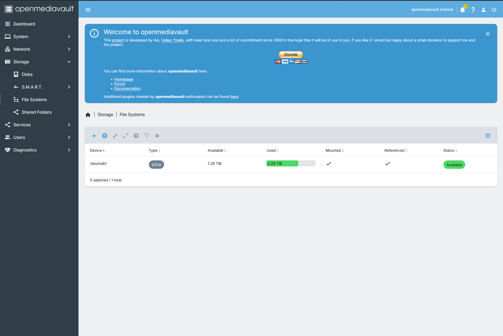

# Open Media Vault

## overview
As my goal was to get out of paying for subscription services, I needed more storage. Rather than buying a NAS which was being listed for around $500 aud on marketplace, especially because I would need to buy harddrives separetly. So, I went with a cheaper alternative on amazon. I bought a DAS Yottamaster DataStriver with 4 HDD bays. 
\
\
I needed to now configure that DAS so I can access the harddrives on my other devices like a NAS. I used Open Media Vault (OMV), as it is lightweight, free, and has a managed WEB GUI \


## specs
**DAS**: Yottamaster DataStriver \
**HDD**: Western Digital 4TB Red Plus drive \
**DAS connection type**: USB 

## setup
static ip: 192.168.1.244 \
OMV VM ID: 102


## Mounting the DAS Drive

Because the storage array is housed in an external DAS connected to the Proxmox host, the physical disk must be explicitly passed through to the OpenMediaVault (OMV) virtual machine at the hypervisor level.

1. **Locate the persistent disk ID on the Proxmox host:**
   ```bash
   ls /dev/disk/by-id/
   ```

2. **Pass the physical drive through to the OMV VM (e.g., VM ID 102):**
    ```bash
    qm set (omv_id) -scsi2 /dev/disk/by-id/(drive)
    ```
    
3. **Open OMV web GUI 
    - verify that the disk appears natively in Storage->Disks \
      
    - Storage > File Systems to format and mount the partition. \
      

Alternatively, you could do the mounting via the terminal in ```/etc/fstab```.
